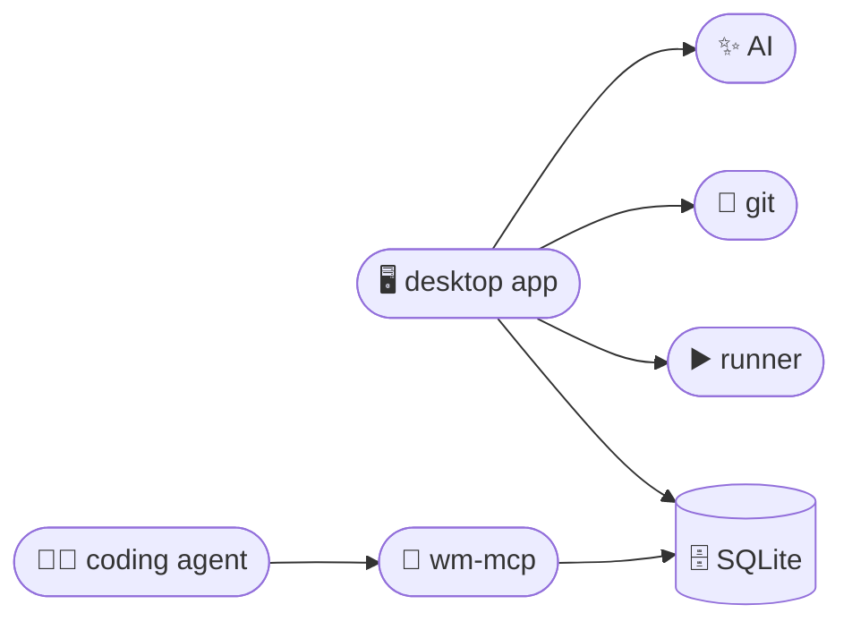

<div align="center">


# Workspace Manager

**Get your local projects running without the terminal shuffle.**

Workspace Manager brings your projects, startup setup, and live output into one desktop app, with an MCP server that agents can drive.
Group related apps into a workspace, then start, stop, or restart them from one place.

[](https://go.dev/)
[](https://wails.io/)
[](https://react.dev/)
[](https://www.typescriptlang.org/)
[](https://bun.sh/)
[](https://sqlite.org/)

</div>

---



## 🚀 How it fits together

- **The desktop app** does the work: it owns the database, the process runner, git,
  worktrees, blueprints and the AI. There is no background server.
- **`wm-mcp`** is the MCP server for a coding agent (Claude Code and any other
  MCP client). It opens the same database, so the app does not need to be
  running, and gives the agent your workspaces, apps, config sets, env vars,
  templates, command lists and blueprints, plus a guide for managing them. It
  edits configuration but **runs nothing**: to run an app it hands the agent
  the commands. Git and the AI stay in the app. Values marked as excluded from
  AI stay hidden from it.
- The two coordinate through the database: edits the agent makes show up in the
  app, and an app the agent is running shows as "by agent" there.

## 🤖 Agent quick start

Point your MCP client at `wm-mcp.exe` (see `mcp/README.md` for the JSON config
and the tool list). Claude Code:

```bash
claude mcp add workspace-manager -- C:/path/to/wm-mcp.exe
```

An agent can then read the guide (`wm_guide`), register an app, set its run
commands and env vars, and have the exact commands to start it handed back.

Env vars and templates marked as excluded from AI are hidden from the MCP
server: their values are blank in output and writes to them are refused. Set
them in the desktop app. They still reach the app when it runs through
`wm_run`, but never the agent's conversation.

`WM_DATA_DIR` points both programs at another data folder, which is how tests
run in isolation.

## 🎯 The problem it solves

Getting into a project often means opening several terminal tabs, remembering
environment settings, starting services in the right order, and hunting through
output when something breaks. When you switch between projects or run a
frontend, API, and worker together, that setup steals time before you can get
to the work.

> 💡 Workspace Manager saves that setup with each app and gives you one place to
> run and monitor a workspace, from the app or from an agent.

## ✨ Features

| | Feature | What it does |
|:---:|---|---|
| 🗂️ | **Keep related apps together** | Group related apps into a workspace and see all of them on one screen, with each app's status and running count visible at a glance. |
| ⚡ | **Start each app with one command** | Give an app its commands once, then run, stop, or reload it with one click or one agent tool call. Commands run in parallel or in sequence, depending on what the app needs. |
| 🧩 | **Keep project setup reusable** | Save run commands, environment variables, and file templates in named config sets such as `dev` and `staging`. Switch setups without retyping variables or preparing files by hand. |
| 📡 | **See what's running** | Check each app's status and follow live, searchable output in one place. When a development server prints its local URL, open it with a click. |
| 🤖 | **Drive it from an agent** | The MCP server gives an agent your apps and a guide, so it can create apps, change config, and be told how to run them. |
| 🌿 | **Branch and worktree tools** | Create, rename, check out, pull, push, and delete local branches, and run an app's setup inside a fresh git worktree with its shared files linked. |
| 🪄 | **Create new projects from a recipe** | Save setup commands as blueprints and use them to create new apps. If a command asks for input, answer it in the built-in terminal. |
| 🔌 | **Find local port conflicts** | See which process is using a listening port and stop it. |

## 📁 Project layout

| Path | Role |
|---|---|
| `api/` | The contract both programs share: types, the method registry, `lib` helpers |
| `core/` | What both programs run on: `db`, `ops` (write operations), `handlers` (one per method, with the agent rules), `services` (runner, git, templates, blueprints), `native` |
| `mcp/` | The `wm-mcp` MCP server: curated tools (`cmd/wm-mcp`) and the agent guide |
| `gui/` | The Wails desktop app (with the AI in `gui/ai`) and the React frontend |
| `go.work` | Ties the Go modules together for development |

## 🛠️ Development

Needs [Go](https://go.dev/) 🐹, [Wails](https://wails.io/) v2 and [Bun](https://bun.sh/) 🥟.

From the repo root:

```bash
go build ./api/... ./core/... ./gui/... ./mcp/...   # every module
go test ./api/... ./core/... ./gui/... ./mcp/...    # unit tests
go build -o build/bin/wm-mcp ./mcp/cmd/wm-mcp
.\build.ps1                         # MCP + GUI -> build/bin
```

From `gui/`:

```bash
wails dev                  # Wails + Vite (port 5174)
wails build -o ../../../build/bin/workspace-manager.exe
                           # production native app -> build/bin
wails generate module      # regenerate gui/frontend/wailsjs after Go changes
```

From `gui/frontend/` (run `bun install` once):

| Script | What it does |
|---|---|
| `bun run dev` | Start the Vite dev server |
| `bun run build` | Build the frontend for production |
| `bun run lint` | Lint the frontend |
| `bun run typecheck` | Type-check with `tsc` |

Schema or query changes: edit `core/db/schema.sql` or `core/db/queries.sql`,
then run `sqlc generate` from the repo root.

---

<div align="center">

<sub>Built with 🐹 Go and ⚛️ React, shipped as a native desktop app via Wails.</sub>

</div>
