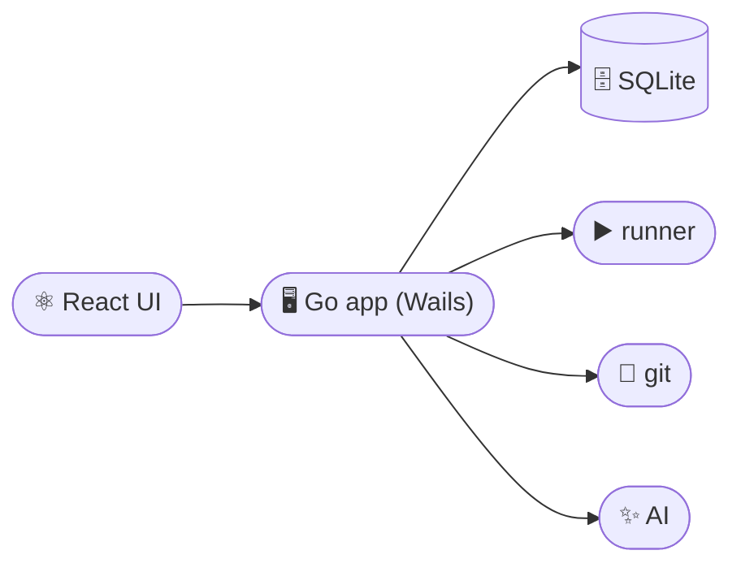

<div align="center">


# Workspace Manager

**Get your local projects running without the terminal shuffle.**

Workspace Manager brings your projects, startup setup, and live output into one desktop app.
Group related apps into a workspace, then start, stop, or restart them from one place.

[](https://go.dev/)
[](https://wails.io/)
[](https://react.dev/)
[](https://www.typescriptlang.org/)
[](https://bun.sh/)
[](https://sqlite.org/)

</div>

---



## 🚀 How it fits together

One native app. The React interface talks to the Go side through Wails bindings;
the Go side owns the SQLite database, the process runner (with real terminals),
git and worktrees, blueprints and the AI features. There is no server or
background process, and `WM_DATA_DIR` points the app at another data folder,
which is how tests run in isolation.

## 🎯 The problem it solves

Getting into a project often means opening several terminal tabs, remembering
environment settings, starting services in the right order, and hunting through
output when something breaks. When you switch between projects or run a
frontend, API, and worker together, that setup steals time before you can get
to the work.

> 💡 Workspace Manager saves that setup with each app and gives you one place to
> run and monitor a workspace.

## ✨ Features

| | Feature | What it does |
|:---:|---|---|
| 🗂️ | **Keep related apps together** | Group related apps into a workspace and see all of them on one screen, with each app's status and running count visible at a glance. |
| ⚡ | **Start each app with one command** | Give an app its commands once, then run, stop, or reload it with one click. Commands run in parallel or in sequence, depending on what the app needs. |
| 🧩 | **Keep project setup reusable** | Save run commands, environment variables, and file templates in named config sets such as `dev` and `staging`. Switch setups without retyping variables or preparing files by hand. |
| 📡 | **See what's running** | Check each app's status and follow live, searchable output in one place. When a development server prints its local URL, open it with a click. |
| 🌿 | **Branch and worktree tools** | Create, rename, check out, pull, push, and delete local branches, and run an app's setup inside a fresh git worktree with its shared files linked. |
| 🪄 | **Create new projects from a recipe** | Save setup commands as blueprints and use them to create new apps. If a command asks for input, answer it in the built-in terminal. |
| 🔌 | **Find local port conflicts** | See which process is using a listening port and stop it. |

## 📁 Project layout

| Path | Role |
|---|---|
| `main.go`, `app.go`, `bind.go` | The Wails app: entry point, the `App` struct and the surface the frontend calls |
| `internal/` | The Go side: `api` (types and the method registry), `handlers`, `ops` (write operations), `services` (runner, git, templates, blueprints), `db`, `native`, `ai` |
| `frontend/` | The React UI |
| `build/` | Wails build assets; `build/bin` is the output |

## 🛠️ Development

Needs [Go](https://go.dev/) 🐹, [Wails](https://wails.io/) v2 and [Bun](https://bun.sh/) 🥟.

From the repo root:

```bash
go build ./...
go test ./...
wails dev                  # Wails + Vite (port 5174)
wails build                # production native app -> build/bin
wails generate module      # regenerate frontend/wailsjs after Go changes
```

From `frontend/` (run `bun install` once):

| Script | What it does |
|---|---|
| `bun run dev` | Start the Vite dev server |
| `bun run build` | Build the frontend for production |
| `bun run lint` | Lint the frontend |
| `bun run typecheck` | Type-check with `tsc` |

Schema or query changes: edit `internal/db/schema.sql` or `internal/db/queries.sql`,
then run `sqlc generate` from the repo root.

---

<div align="center">

<sub>Built with 🐹 Go and ⚛️ React, shipped as a native desktop app via Wails.</sub>

</div>
