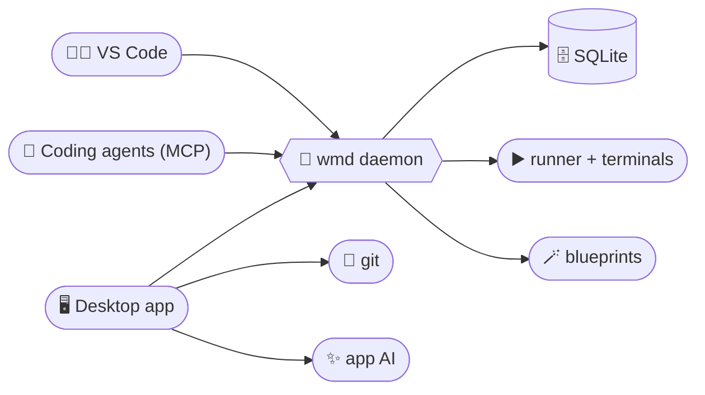

<div align="center">


# Workspace Manager

**Get your local projects running without the terminal shuffle.**

Workspace Manager brings your projects, startup setup, and live output into one place.
Group related apps into a workspace, then start, stop, or restart them from the desktop app,
from VS Code, or from your AI coding agent. They all share one background daemon, so every
view stays in sync and your apps keep running when you close the window.

[](https://go.dev/)
[](https://wails.io/)
[](https://react.dev/)
[](https://www.typescriptlang.org/)
[](https://bun.sh/)
[](https://sqlite.org/)
[](cmd/wm-mcp/README.md)
[](vscode/README.md)

</div>

---



## 🎯 The problem it solves

Getting into a project often means opening several terminal tabs, remembering
environment settings, starting services in the right order, and hunting through
output when something breaks. When you switch between projects or run a
frontend, API, and worker together, that setup steals time before you can get
to the work.

> 💡 Workspace Manager saves that setup with each app and gives you one place to
> run and monitor a workspace, wherever you happen to be working.

## 🚪 Pick your door

One setup, three ways in. Change something in any of them and the others update live.

| | Client | Best when you want to | Learn more |
|:---:|---|---|---|
| 🖥️ | **Desktop app** | See every workspace at once, follow live terminals, manage branches and worktrees, draft blueprints with AI. | this page |
| 🧑‍💻 | **VS Code extension** | Stay in the editor: switch config sets from the status bar, edit templates in a normal tab, and press Dev, Build or Prod without leaving your code. | [vscode/](vscode/README.md) |
| 🤖 | **MCP server** | Let Claude Code or any MCP agent list your apps, tweak config, and start or stop them, with secrets you've marked private kept out of its sight. | [cmd/wm-mcp/](cmd/wm-mcp/README.md) |

## 🧩 One daemon behind it all

A small background program, `wmd`, owns your data and runs your apps. Every client
starts it on demand, so there is nothing to launch by hand.

- **Your apps outlive your windows.** Close the app or VS Code and your servers keep running. Open any client later and pick up the live output where it left off.
- **Everything stays in sync.** A change made in one client shows up in the others as it happens.
- **One home for your setup.** Workspaces, config sets, variables, templates and run commands live in a single local SQLite database.
- **Quiet by itself.** The daemon exits once nothing is running and no client is connected.
- **Safe by default.** Agents only get the tools meant for them, and variables or templates you exclude from AI never reach one. The VS Code extension connects over loopback with a private token that only you can read.

`WM_DATA_DIR` points everything at another data folder, which is how tests and sandboxes stay isolated.

## ✨ Features

| | Feature | What it does |
|:---:|---|---|
| 🗂️ | **Keep related apps together** | Group related apps into a workspace and see all of them on one screen, with each app's status and running count visible at a glance. |
| ⚡ | **Start each app with one command** | Give an app its commands once, then run, stop, or reload it with one click. Setup, dev, build and prod each get their own list, run in parallel or in sequence. |
| 🧩 | **Keep project setup reusable** | Save run commands, environment variables, and file templates in named config sets such as `dev` and `staging`. Switch setups without retyping variables or preparing files by hand. |
| 📡 | **See what's running** | Check each app's status and follow live, searchable output in one place. When a development server prints its local URL, open it with a click. |
| 🧑‍💻 | **Work from VS Code** | Switch sets, edit env vars and snapshot templates, preview them rendered, and run commands with output in a VS Code terminal. Variables are injected into your integrated terminals too. |
| 🤖 | **Hand it to your agent** | An MCP server exposes workspaces, config, runs and blueprints to coding agents, and a set of non-interactive commands lets VS Code agents do the same. |
| 🌿 | **Branch and worktree tools** | Create, rename, check out, pull, push, and delete local branches, and run an app's setup inside a fresh git worktree with its shared files linked. |
| 🪄 | **Create new projects from a recipe** | Save setup commands as blueprints and use them to create new apps. If a command asks for input, answer it in the built-in terminal. |
| 🔌 | **Find local port conflicts** | See which process is using a listening port and stop it. |

## 📁 Project layout

| Path | Role |
|---|---|
| `main.go` | The Wails entry point |
| `gui` | The desktop app's Go side: the surface the frontend calls, its link to the daemon, file dialogs; `ai` and `git` live below it |
| `cmd/wmd` | The background daemon |
| `cmd/wm-mcp` | MCP server so coding agents can drive the daemon ([details](cmd/wm-mcp/README.md)) |
| `vscode` | VS Code extension for config sets, env vars, templates and run buttons ([details](vscode/README.md)) |
| `daemon` | What `wmd` runs: `db`, `ops`, `services` (runner, templates, blueprints), `handlers` |
| `shared` | What every side uses: `api` (types and the method list), `rpc`, `client`, `native` |
| `frontend/` | The React UI |
| `build/` | Wails build assets; `build/bin` is the output |

## 🛠️ Development

Needs [Go](https://go.dev/) 🐹, [Wails](https://wails.io/) v2 and [Bun](https://bun.sh/) 🥟 (and Node, to build the VS Code extension).

From the repo root:

```bash
go build ./...
go test ./...
wails dev                  # Wails + Vite (port 5174); needs wmd, see AGENTS.md
.\build.ps1                # everything -> build/bin
wails generate module      # regenerate frontend/wailsjs after Go changes
```

`.\build.ps1` produces the whole kit in `build/bin`:

| File | What it is |
|---|---|
| `workspace-manager.exe` | The desktop app |
| `wmd.exe` | The daemon (keep it next to the app and the MCP server) |
| `wm-mcp.exe` | The MCP server for coding agents |
| `workspace-manager-*.vsix` | The VS Code extension |

From `frontend/` (run `bun install` once):

| Script | What it does |
|---|---|
| `bun run dev` | Start the Vite dev server |
| `bun run build` | Build the frontend for production |
| `bun run lint` | Lint the frontend |
| `bun run typecheck` | Type-check with `tsc` |

Schema or query changes: edit `daemon/db/schema.sql` or `daemon/db/queries.sql`,
then run `sqlc generate` from the repo root.

---

<div align="center">

<sub>Built with 🐹 Go and ⚛️ React, shipped as a desktop app, a daemon, an MCP server and a VS Code extension.</sub>

</div>
