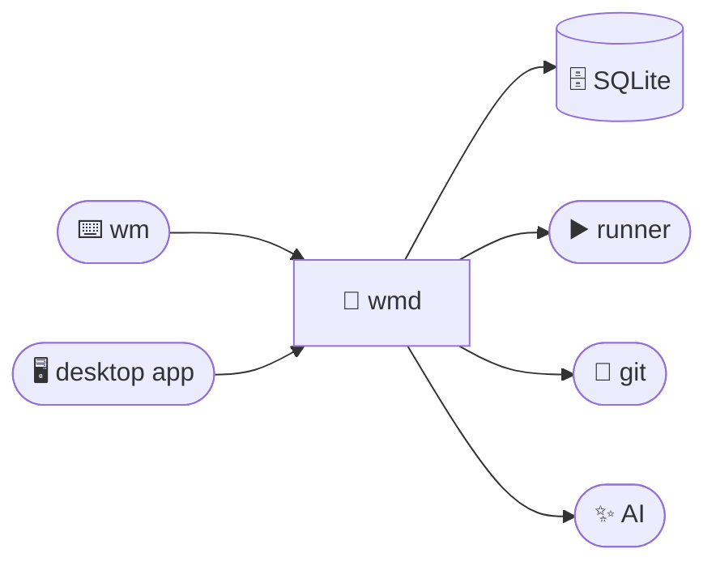

<div align="center">


# Workspace Manager

**Get your local projects running without the terminal shuffle.**

Workspace Manager brings your projects, startup setup, and live output into one desktop app, and now into one CLI that agents can drive.
Group related apps into a workspace, then start, stop, or restart them from one place.

[](https://go.dev/)
[](https://wails.io/)
[](https://react.dev/)
[](https://www.typescriptlang.org/)
[](https://bun.sh/)
[](https://sqlite.org/)

</div>

---



## 🚀 How it fits together

- **`wmd`** is the background server. It owns the database, the process runner,
  the blueprints and the AI, and listens on a local socket. One instance serves
  every client.
- **`wm`** is the CLI. It covers every feature except the AI, so an agent can
  drive the whole app: apps and config sets, env vars, templates, command
  lists, the runner, git, worktrees, ports and blueprints. It starts `wmd` on
  demand and stops it when idle.
- **The desktop app** is a client too. It talks to the same server, so a run
  started in the app shows up in the CLI and the other way around.

## ⌨️ CLI quick start

```bash
wm workspace add work                          # create a workspace
wm app add web --workspace work --path .       # register an app
wm env set API_URL --value http://localhost:3000 web
wm commands set run --app web --command "npm run dev" --label dev
wm run web --wait-ready                        # start it, wait for its URL
wm logs web --follow                           # stream the output
wm stop web                                    # stop it
```

Every command takes `--json`. Exit codes tell an agent what happened:
`0` ok, `1` failed, `2` usage, `3` not found, `4` conflict (for example, an app
that is already running), `5` the server is unreachable.

Env vars and templates marked as excluded from AI are hidden from the CLI:
their values are blank in output and writes to them are refused. Set them in
the desktop app.

`WM_DATA_DIR` points both the server and its clients at another data folder,
which is how tests run in isolation.

## 🎯 The problem it solves

Getting into a project often means opening several terminal tabs, remembering
environment settings, starting services in the right order, and hunting through
output when something breaks. When you switch between projects or run a
frontend, API, and worker together, that setup steals time before you can get
to the work.

> 💡 Workspace Manager saves that setup with each app and gives you one place to
> run and monitor a workspace, from the app or from the CLI.

## ✨ Features

| | Feature | What it does |
|:---:|---|---|
| 🗂️ | **Keep related apps together** | Group related apps into a workspace and see all of them on one screen, with each app's status and running count visible at a glance. |
| ⚡ | **Start each app with one command** | Give an app its commands once, then run, stop, or reload it with one click or one `wm run`. Commands run in parallel or in sequence, depending on what the app needs. |
| 🧩 | **Keep project setup reusable** | Save run commands, environment variables, and file templates in named config sets such as `dev` and `staging`. Switch setups without retyping variables or preparing files by hand. |
| 📡 | **See what's running** | Check each app's status and follow live, searchable output in one place. When a development server prints its local URL, open it with a click or wait for it with `--wait-ready`. |
| 🤖 | **Drive it from an agent** | The CLI speaks JSON and uses exit codes, so an agent can create apps, change config, run and stop them, and manage their git state. |
| 🌿 | **Branch and worktree tools** | Create, rename, check out, pull, push, and delete local branches, and run an app's setup inside a fresh git worktree with its shared files linked. |
| 🪄 | **Create new projects from a recipe** | Save setup commands as blueprints and use them to create new apps. If a command asks for input, answer it in the built-in terminal. |
| 🔌 | **Find local port conflicts** | See which process is using a listening port and stop it. |

## 📁 Project layout

| Path | Role |
|---|---|
| `api/` | The contract both sides share: types, the method registry, the wire protocol (`api/rpc`) and the client (`api/client`) |
| `server/` | The server: `cmd/wmd`, `daemon` (lifecycle, protocol wiring), `handlers` (one per method), `ops` (write operations), `db`, `services` (runner, git, templates, blueprints), `ai`, `native`, `lib` |
| `cli/` | The `wm` command: `cmd/wm` |
| `gui/` | The Wails desktop app and the React frontend |
| `go.work` | Ties the Go modules together for development |

## 🛠️ Development

Needs [Go](https://go.dev/) 🐹, [Wails](https://wails.io/) v2 and [Bun](https://bun.sh/) 🥟.

From the repo root:

```bash
go build ./api/... ./server/... ./cli/... ./gui/...   # every module
go test ./api/... ./server/...      # unit and protocol tests
go build -o build/bin/wmd ./server/cmd/wmd
go build -o build/bin/wm  ./cli/cmd/wm
```

From `gui/`:

```bash
wails dev                  # Wails + Vite (port 5174)
wails build                # production native app -> gui/build/bin
wails generate module      # regenerate gui/frontend/wailsjs after Go changes
```

From `gui/frontend/` (run `bun install` once):

| Script | What it does |
|---|---|
| `bun run dev` | Start the Vite dev server |
| `bun run build` | Build the frontend for production |
| `bun run lint` | Lint the frontend |
| `bun run typecheck` | Type-check with `tsc` |

Schema or query changes: edit `server/db/schema.sql` or `server/db/queries.sql`,
then run `sqlc generate` from the repo root.

---

<div align="center">

<sub>Built with 🐹 Go and ⚛️ React, shipped as a native desktop app via Wails.</sub>

</div>
